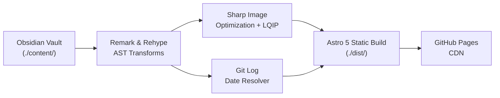
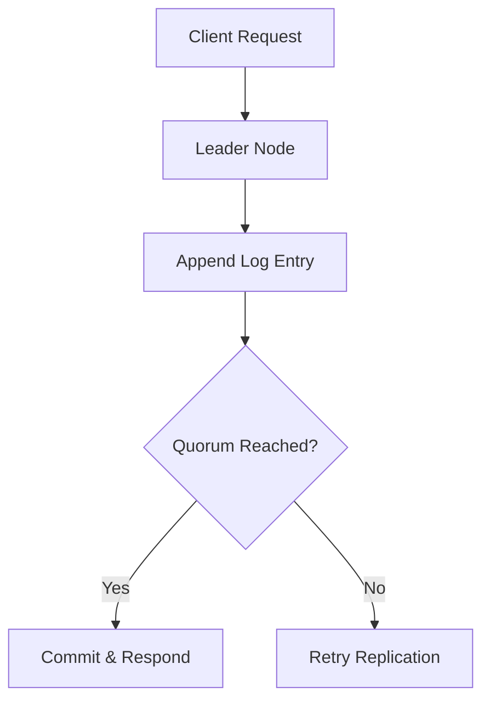
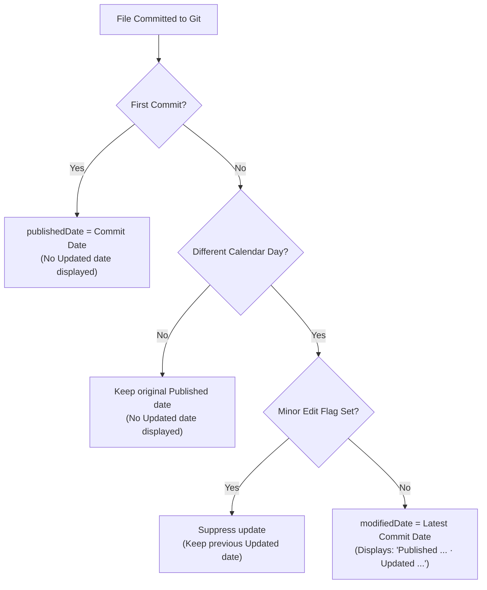

# Mo's Articles — The Complete Writer's Manual 📖

Welcome to the definitive authoring guide for **Mo's Articles**. This manual covers everything you need to know to write, format, organize, preview, and publish articles and technical notes using your local Obsidian vault or preferred markdown editor.

---

## Table of Contents

1. [Architecture & Philosophy](#1-architecture--philosophy)
2. [Vault Organization, URL Routing & Sorting](#2-vault-organization-url-routing--sorting)
3. [Frontmatter Reference](#3-frontmatter-reference)
4. [Master Markdown & Obsidian Syntax Guide](#4-master-markdown--obsidian-syntax-guide)
   - [Standard Markdown](#standard-markdown)
   - [Obsidian WikiLinks](#obsidian-wikilinks)
   - [Highlights & Inline Tags](#highlights--inline-tags)
   - [Private Author Comments](#private-author-comments)
   - [Obsidian Callouts (Admonitions)](#obsidian-callouts-admonitions)
   - [Mathematical Formulas (KaTeX)](#mathematical-formulas-katex)
   - [Mermaid Diagrams](#mermaid-diagrams)
   - [Images & Media Pipeline](#images--media-pipeline)
   - [Code Blocks & Syntax Highlighting](#code-blocks--syntax-highlighting)
   - [Footnotes](#footnotes)
5. [Writer CLI & Daily Workflows](#5-writer-cli--daily-workflows)
   - [CLI Scaffolding Tool](#cli-scaffolding-tool)
   - [Obsidian Templater Snippet](#obsidian-templater-snippet)
   - [Vault Validation Linter](#vault-validation-linter)
   - [Local Development & Draft Preview](#local-development--draft-preview)
6. [Git Dates & Publishing Automation](#6-git-dates--publishing-automation)
   - [Automatic Date Resolution](#automatic-date-resolution)
   - [Minor Edit Exclusions](#minor-edit-exclusions)
   - [Future-Dated Scheduled Posts](#future-dated-scheduled-posts)
   - [Safe File Renaming](#safe-file-renaming)
7. [Site Configuration & Customization](#7-site-configuration--customization)
8. [Reader Features & Accessibility](#8-reader-features--accessibility)
9. [Verification & Publishing Checklist](#9-verification--publishing-checklist)

---

## 1. Architecture & Philosophy

**Mo's Articles** is designed around a single guiding principle: **your markdown vault is the single source of truth**.

- **Zero-Friction Writing**: You write notes in `./content/` using standard markdown or Obsidian conventions. You do not need to configure Astro routing, build complex page components, or manually manage metadata.
- **Build-Time Static Delivery**: Markdown enhancements—including heading anchor buttons, responsive table wrappers, external link attributes, KaTeX math, and multi-format responsive `<picture>` elements—are pre-rendered at build time with minimal client-side JavaScript.
- **Git-Derived Timestamps**: Dates are derived directly from your repository's commit history (`git log --follow`). You never have to manually update `modifiedDate` or maintain timestamp frontmatter unless you want to override it.



---

## 2. Vault Organization, URL Routing & Sorting

All article content lives in the `./content/` directory at the root of the repository.

### Directory Structure

```text
content/
├── systems/                               # Category folder: "systems"
│   ├── distributed-consensus-raft.md      # URL: /systems/distributed-consensus-raft/
│   └── zero-copy-networking-linux.md      # URL: /systems/zero-copy-networking-linux/
├── coffee/                                # Category folder: "coffee"
│   ├── espresso-extraction.md             # URL: /coffee/espresso-extraction/
│   └── pour-over-brewing.md               # URL: /coffee/pour-over-brewing/
├── writing/                               # Category folder: "writing"
│   └── crafting-clear-thoughts.md         # URL: /writing/crafting-clear-thoughts/
├── attachments/                           # Shared image & media folder
│   └── architecture-diagram.png
├── _drafts/                               # Private folder (IGNORED by production build)
│   └── secret-ideas.md
├── _templates/                            # Template folder (IGNORED by production build)
└── .obsidian/                             # Obsidian configuration (IGNORED)
```

### Routing Rules

1. **Category Mapping**: Any first-level folder inside `./content/` becomes the article's category and URL prefix (e.g., `./content/systems/` $\to$ `/systems/...`).
2. **Slug Mapping**: The file name (or custom `slug` frontmatter) is slugified to generate the article URL (e.g., `Espresso Extraction.md` $\to$ `/coffee/espresso-extraction/`). Unicode letters and numbers (including Arabic characters) are preserved cleanly.
3. **Category Hubs**: Each category automatically gets an index page listing all its articles (e.g., `/systems/`, `/coffee/`, `/writing/`).
4. **Root Files**: Any markdown file placed directly in `./content/` defaults to the `uncategorized` category (URL: `/uncategorized/<slug>/`).
5. **Private / Ignored Folders**: Any folder or file starting with an underscore (`_`) or dot (`.`)—plus the shared `attachments/` media folder—is excluded from article routing. Use `_drafts/`, `_notes/`, or `_templates/` for private scratchpads.

### Ordering & Sorting Rules

- **Home Page Categories (Newest Activity First)**: Categories on the home page are sorted by which category has the **most recently published article** (`latestDate` descending). Whenever you add a new article to a category, that category automatically moves to the top of the home page.
- **Articles Within a Category (Oldest to Newest)**: Inside each category section (both on the home page and on `/<category>/` hub pages), articles are sorted chronologically from **oldest to newest** (`publishedDate` ascending) so foundational articles appear first.

---

## 3. Frontmatter Reference

Every article begins with a YAML frontmatter block enclosed by triple hyphens (`---`). All fields are optional.

### Frontmatter Schema

| Property | Type | Default | Description |
| :--- | :--- | :--- | :--- |
| `title` | `string` | *(First `# H1` or Filename)* | The human-readable headline of the article. |
| `description` | `string` | Auto-excerpt | A 1–2 sentence summary used for SEO meta tags, RSS descriptions, and social sharing cards. |
| `tags` | `string[] \| string` | `[]` | List of topics (normalized to lowercase slugs). Merged with any inline `#tags` found in the body. |
| `draft` | `boolean` | `false` | When `true`, hides the post from production builds, RSS, and sitemaps. Fully visible in `pnpm run dev`. |
| `comments` | `boolean` | `true` | Set to `false` to disable the Giscus comment section for this specific article. |
| `minor` | `boolean` | `false` | Set to `true` when committing a typo fix or formatting tweak so the "Modified" date is not bumped. |
| `published` / `publishDate` | `string` (ISO) | Git 1st commit | Manual override for the original publication date (e.g. `2026-01-15`). |
| `modified` / `modifiedDate` | `string` (ISO) | Git last commit | Manual override for the last updated date (e.g. `2026-02-01`). |
| `slug` | `string` | *(Filename slug)* | Custom URL slug override for the article. |
| `lang` | `string` | `'en'` | BCP-47 language tag for the article (e.g. `'en'`, `'ar'`). |
| `dir` | `'ltr' \| 'rtl'` | `'ltr'` | Text direction for the article (`'rtl'` enables right-to-left layout). |
| `redirects` | `string[]` | `[]` | List of legacy URL paths that should redirect to this article. |

### Minimal Frontmatter Example

```yaml
---
title: "Understanding Espresso Ratios"
description: "A quick practical guide to dialing in brew ratios for lighter roast espresso."
tags:
  - coffee
  - espresso
---
```

### Complete Frontmatter Example

```yaml
---
title: "Distributed Consensus and Raft Internals"
description: "How leader election, log replication, and safety invariants work in practice."
tags:
  - distributed-systems
  - consensus
  - raft
draft: false
comments: true
minor: false
published: "2026-01-10"
modified: "2026-03-04"
lang: "en"
dir: "ltr"
---
```

---

## 4. Master Markdown & Obsidian Syntax Guide

### Standard Markdown

All CommonMark and GitHub Flavored Markdown (GFM) constructs are supported:

#### Headings
```markdown
# Heading 1 (Article Title - stripped from body if it matches the article title)
## Heading 2 (Major Section)
### Heading 3 (Subsection)
#### Heading 4 (Deep Dive)
```
> [!TIP]
> Headings H2 through H6 automatically receive slug IDs and clickable `#` anchor buttons at build time (`rehype-article-enhancements`). Clicking a heading's `#` copies its deep-link URL to your clipboard.

#### Inline Formatting
```markdown
**Bold text** or __bold text__
*Italic text* or _italic text_
~~Strikethrough text~~
`Inline code span`
```

#### Lists & Checklists
```markdown
- Unordered item
  - Nested unordered item
1. Ordered item
   1. Nested ordered item

- [x] Completed task item
- [ ] Incomplete task item
```

#### Tables
```markdown
| Parameter | Unit | Target Range |
| :--- | :---: | ---: |
| Dose | grams | 18.0 – 18.5 |
| Yield | grams | 36.0 – 40.0 |
| Extraction Time | seconds | 27 – 32 |
```
> [!NOTE]
> All Markdown tables are automatically wrapped in `<div class="table-wrapper">` at build time so wide tables scroll horizontally on mobile devices without breaking the layout.

---

### Obsidian WikiLinks

Internal cross-linking between articles is seamless using native Obsidian `[[WikiLink]]` syntax. The engine automatically indexes all vault files by filename, slug, relative path, and title.

```markdown
<!-- Link by filename or slug -->
Read more in [[espresso-extraction]].

<!-- Link with custom display text (alias) -->
Check out my [[espresso-extraction|comprehensive espresso dialing guide]].

<!-- Link directly to a specific section heading -->
See the section on [[espresso-extraction#Pressure Profiling]].

<!-- Link to a section with custom display text -->
Review [[espresso-extraction#Pressure Profiling|pressure profiling techniques]].
```

> [!NOTE]
> **Graceful Broken Link Fallbacks**: If you link to a note that hasn't been written yet (e.g., `[[future-concept]]`), the build will render a styled visual indicator (`<span class="wikilink-broken" title="Broken link: ...">`) in development. Running `pnpm run validate` (or `pnpm run build`) audits all WikiLinks—including `#Heading` anchors—before deploying.

---

### Highlights & Inline Tags

#### Text Highlights
Wrap phrases in double equals (`==`) to render an accessible `<mark class="highlight">` styled with warm editorial amber:
```markdown
Extraction yields above ==22%== often reveal astringent, dry tannins.
```

#### Inline Tags
Type a `#tag` directly in your text paragraphs:
```markdown
This concept applies to both #espresso and #pour-over methods.
```
The engine automatically:
1. Renders the tag as a clickable link (`<a href="/tags/espresso/" class="tag">#espresso</a>`).
2. Extracts and merges inline tags with your frontmatter `tags` so the article is indexed on `/tags/espresso/` and `/tags/pour-over/`.

---

### Private Author Comments

Use Obsidian double percentage signs (`%%`) to leave author notes, todo reminders, or references:
```markdown
The primary flow resistance stems from the compacted fines layer.
%% TODO: Re-verify microscopic grind distribution data from Rao paper %%
As water percolates downwards, pressure stabilizes.
```
> [!IMPORTANT]
> Everything between `%% ... %%` (both inline and multi-line blocks, outside of code blocks) is **completely stripped** before rendering and excerpt generation. Readers viewing page source or RSS feeds will never see your private comments.

---

### Obsidian Callouts (Admonitions)

Callouts provide visual distinction for notes, tips, warnings, and alerts. They support custom titles and optional folding.

#### Basic Callout Syntax
```markdown
> [!note]
> This is a default informational callout.

> [!tip] Extraction Pro-Tip
> Use a WDT tool with 0.3mm needles to eliminate micro-clumps before tamping.

> [!warning] Temperature Sensitivity
> Water temperatures exceeding 96°C can scorch delicate floral aromatics.

> [!danger] High Pressure Warning
> Operating your rotary pump above 11 bars risks damaging gasket seals.
```

#### Foldable Callouts
Add `+` to make a callout foldable (expanded by default), or `-` to make it collapsed by default (rendered using native `<details>` and `<summary>` elements):
```markdown
> [!tip]+ Expandable Dialing Checklist
> 1. Measure 18.0g dry dose.
> 2. Perform thorough WDT puck distribution.
> 3. Tamp level with 15kg pressure.
> 4. Flush grouphead for 2 seconds.

> [!note]- Deep-Dive Derivation (Click to Expand)
> Darcy's law describes fluid flow through porous puck beds:
> $Q = \frac{-\kappa A}{\mu} \frac{\Delta P}{L}$
```

#### Supported Callout Types & Aliases

| Category | Supported Markers | Color Accent |
| :--- | :--- | :--- |
| **Note / Info** | `[!note]`, `[!info]`, `[!todo]`, `[!abstract]`, `[!summary]`, `[!tldr]` | Blue Accent |
| **Tip / Success** | `[!tip]`, `[!hint]`, `[!important]`, `[!success]`, `[!check]`, `[!done]`, `[!question]`, `[!help]`, `[!faq]` | Emerald Green |
| **Warning** | `[!warning]`, `[!caution]`, `[!attention]` | Warm Amber |
| **Danger / Critical** | `[!danger]`, `[!error]`, `[!bug]`, `[!failure]`, `[!fail]`, `[!missing]`, `[!example]`, `[!quote]`, `[!cite]` | Crimson Red |

---

### Mathematical Formulas (KaTeX)

Mathematical equations are parsed via `remark-math` and `rehype-katex` with zero client-side JavaScript overhead. KaTeX generates clean HTML and MathML during the static build, and the KaTeX stylesheet is only loaded on pages that contain math formulas.

#### Inline Math
Wrap LaTeX expressions in single dollar signs (`$`):
```markdown
The relationship between mass flow and pressure drop is given by $Q = \frac{\Delta P}{R_{\text{puck}}}$.
```

#### Display / Block Math
Wrap equations in double dollar signs (`$$`):
```markdown
$$
\text{TDS} = \frac{\text{Yield Mass} \times \text{Refractometer Brix} \times 0.85}{\text{Dry Coffee Dose}}
$$
```

#### Multiline Equations & Alignments
```markdown
$$
\begin{aligned}
\nabla \cdot \mathbf{E} &= \frac{\rho}{\varepsilon_0} \\
\nabla \cdot \mathbf{B} &= 0 \\
\nabla \times \mathbf{E} &= -\frac{\partial \mathbf{B}}{\partial t} \\
\nabla \times \mathbf{B} &= \mu_0 \left(\mathbf{J} + \varepsilon_0 \frac{\partial \mathbf{E}}{\partial t}\right)
\end{aligned}
$$
```

---

### Mermaid Diagrams

Create diagrams, architecture charts, and flowcharts directly in your markdown using fenced `mermaid` code blocks. Mermaid is dynamically loaded only on pages that contain `mermaid` blocks and automatically re-renders to match the active **Latte** or **Espresso** theme.

````markdown

````

---

### Images & Media Pipeline

The image pipeline (`scripts/optimize-images.mjs`) automatically processes images in `./content/` and produces multi-resolution **AVIF** and **WebP** variants, blurred low-quality image placeholders (**LQIP**), and an interactive zoom-and-pan lightbox.

#### Image Storage Locations
You can place images in any of these locations:
1. **Shared vault attachments folder**: `./content/attachments/my-image.png` *(Recommended for Obsidian)*
2. **Co-located with your article**: `./content/<category>/my-image.png`
3. **In the public directory**: `./public/images/my-image.png`

> [!TIP]
> If two images in different folders share the same filename, reference them by their path relative to `./content/` (e.g., `![[attachments/diagram.png]]` or `![[systems/diagram.png]]`) to disambiguate.

#### Syntax Options

##### 1. Obsidian Embed Syntax (Recommended)
```markdown
<!-- Default responsive embed -->
![[espresso-crema.png]]

<!-- Embed with explicit max-width (e.g. 500px) -->
![[espresso-crema.png|500]]

<!-- Embed with custom caption / alt text -->
![[espresso-crema.png|Microscopic view of CO2 bubble suspension in crema]]

<!-- Embed with both custom caption and explicit width -->
![[espresso-crema.png|Microscopic view of CO2 bubble suspension in crema|500]]
```

##### 2. Standard Markdown Syntax
```markdown

```

#### What Happens Under the Hood
1. **Multi-Format & Multi-Resolution Generation**: Sharp generates AVIF (`4:4:4` chroma subsampling for graphics/diagrams, `4:2:0` for photos) and WebP variants across responsive breakpoints (`480w`, `768w`, `1080w`, `1440w`, `1920w`, up to `2160w` intrinsic cap). SVG files are minified with `svgo`.
2. **Blurred LQIP Placeholders**: Non-transparent images receive an inline blurred WebP placeholder that fades out smoothly once the full image finishes decoding. Transparent PNGs skip the LQIP background so alpha channels remain crisp.
3. **Priority & Lazy Loading**: The first image in an article loads eagerly with high priority (`loading="eager" fetchpriority="high"`); subsequent images load lazily (`loading="lazy"`).
4. **Interactive Zoom & Pan Lightbox**:
   - **Desktop**: Click any article image (or focus it and press <kbd>Enter</kbd> / <kbd>Space</kbd>) to open the theme-aware lightbox. Use the **scroll wheel** to zoom in and out (`1x` to `5x`) anchored at your cursor, **click and hold** to drag/pan around when zoomed in, or **double-click** to toggle zoom (`1x` $\leftrightarrow$ `2.5x`).
   - **Mobile / Touch**: Use **two fingers to pinch-to-zoom** (`1x` to `5x`), **one finger to drag/pan** around when zoomed in, or **double-tap** to toggle zoom.
   - **Dismiss**: Click the backdrop, click the top-right close button, or press <kbd>Esc</kbd>.

---

### Code Blocks & Syntax Highlighting

Code blocks are powered by **Shiki** using dual themes (`github-light` for Latte, `github-dark` for Espresso).

````markdown
```typescript
interface ExtractionRecipe {
  doseGrams: number;
  yieldGrams: number;
  targetSeconds: number;
  temperatureCelsius: number;
}

const lightRoast: ExtractionRecipe = {
  doseGrams: 18.5,
  yieldGrams: 42.0,
  targetSeconds: 29,
  temperatureCelsius: 94.5,
};
```
````

#### Features
- **Language Header & Badge**: Displays a header bar with the language label (`CodeBlockEnhancer.astro`).
- **One-Click Copy Button**: Copies the raw code to the clipboard with a `Copied` confirmation state.
- **Horizontal Scroll**: Long lines scroll cleanly without overflowing the viewport.

---

### Footnotes

Create citations and explanatory tangents using standard GFM footnote syntax:

```markdown
Percolation flow dynamics differ markedly from immersion brewing.[^1] Water channeled along the basket walls can cause localized over-extraction.[^2]

[^1]: Immersion brewing maintains a static concentration gradient governed by Fick's first law of diffusion.
[^2]: Wall channeling is often exacerbated by conical filter baskets with smooth side walls.
```

---

## 5. Writer CLI & Daily Workflows

### CLI Scaffolding Tool

Quickly create a new article with pre-populated frontmatter and directory placement using the built-in scaffolding CLI (`scripts/new-article.mjs`):

```bash
# Create an article with category and tags
pnpm run new "Dialing In Washed Geisha" --category coffee --tags espresso,geisha,recipes

# Create a draft article in the default "writing" category
pnpm run new "Notes on Lock-Free Ring Buffers" --category systems --draft
```

#### Options & Flags
- `"Article Title"`: Required positional argument (title string).
- `--category`, `-c <name>`: The parent folder inside `./content/` (default: `writing`).
- `--tags`, `-t <tag1,tag2>`: Comma-separated list of tags.
- `--draft`, `-d`: Create the article with `draft: true`.
- `--force`, `-f`: Overwrite an existing file if one with the same slug already exists.

---

### Obsidian Templater Snippet

If you use Obsidian with the community **Templater** plugin, save the following template inside `content/_templates/article.md`:

```markdown
---
title: "<% tp.file.title %>"
description: ""
published: "<% tp.date.now("YYYY-MM-DD") %>"
tags: []
draft: true
---

Write your article here...
```

Because `_templates/` begins with an underscore, the build and validator automatically ignore it.

---

### Vault Validation Linter

Before committing or deploying, run the vault validation script (`scripts/validate-vault.mjs`) to verify content integrity:

```bash
pnpm run validate
```

#### What It Validates:
1. **Broken WikiLinks & Heading Anchors**: Identifies any `[[note]]` or `[[note#Heading]]` targets whose article or section heading does not exist in `./content/`.
2. **Missing Media**: Flags any `![[image.png]]` or markdown `` references whose files cannot be found.
3. **Oversized Image Warning**: Warns if any image in `./content/` exceeds `1MB` (and `optimize-images.mjs` also warns on images larger than `2000px`).
4. **Slug Collisions**: Ensures two different files don't resolve to the same `category/slug` URL.
5. **Missing Descriptions**: Non-blocking warning for articles without an explicit `description` in frontmatter.
6. **Uncommitted Vault Files**: Alerts you if a markdown file has no Git commit history yet.

---

### Local Development & Draft Preview

Start the Astro local development server (which automatically optimizes images first):

```bash
pnpm run dev
```

- Accessible at: `http://localhost:4321`
- **Drafts Included**: Articles with `draft: true` are visible in local development with a `[DRAFT]` badge.
- **Live Reload**: Edits in `./content/` immediately refresh in your browser.

---

## 6. Git Dates & Publishing Automation

You never need to manually update article timestamps. The publication date resolver (`src/lib/git-dates.ts`) derives dates directly from Git commit history using `git log --follow`.



### Automatic Date Resolution

1. **Published Date**: Set from the **very first commit** that created the file (unless overridden by `published` or `publishDate` in frontmatter).
2. **Modified Date**: Set from the **most recent non-minor commit** of the file (unless overridden by `modified` or `modifiedDate` in frontmatter).
3. **Single-Day Suppression**: If you edit an article on the same UTC calendar day it was published, no "Updated" date is displayed.

### Minor Edit Exclusions

If you are fixing a typo, updating a link, or making minor formatting adjustments, you can prevent the "Updated" timestamp from changing:

- **Method A (Commit Message — Recommended)**: Include `[minor]` or `minor: true` anywhere in your commit message:
  ```bash
  git commit -m "fix typo in raft leader election section [minor]"
  ```
- **Method B (Frontmatter)**: Set `minor: true` in the article's frontmatter to suppress displaying any modified date on that article.

### Future-Dated Scheduled Posts

If you set an explicit future date in your frontmatter:
```yaml
published: "2026-12-01"
```
Production builds (`NODE_ENV=production`) automatically omit the article until that date arrives, while `pnpm run dev` continues showing it locally. The daily GitHub Actions cron workflow (`.github/workflows/deploy.yml`) rebuilds and deploys every day at midnight UTC so scheduled posts go live automatically.

### Safe File Renaming

Because the Git date resolver uses `git log --follow`, renaming or moving an article with `git mv` preserves its original publication history.

---

## 7. Site Configuration & Customization

Global blog metadata, social links, Giscus comments, and analytics are configured in [`site.config.ts`](file:///home/mohamed/My-Articles/site.config.ts).

### Key Settings

```typescript
export const siteConfig: SiteConfig = {
  name: "Mo's Articles",
  tagline: "Software Engineering & Computer Science",
  header: "Articles on Software Engineering & Computer Science",
  author: "Mohamed Khairy",
  description:
    "Articles and technical notes on software engineering and computer science by Mohamed Khairy.",
  url: "https://mo-1kh.github.io",
  basePath: "/My-Articles",
  defaultCategory: "writing",

  socials: {
    github: "https://github.com/Mo-1Kh",
    x: "https://x.com/Mo_1Khairy",
    linkedin: "https://www.linkedin.com/in/mohamed-khairy-swe/",
    email: "mohamedkhairy.swe@gmail.com",
    rss: true,
  },

  comments: {
    enabled: true,
    provider: "giscus",
    repo: "Mo-1Kh/My-Articles",
    repoId: "R_kgDORbZefw",
    category: "Articles Comments",
    categoryId: "DIC_kwDORbZef84C3bQT",
    mapping: "og:title",
    strict: true,
    reactionsEnabled: true,
    emitMetadata: false,
    inputPosition: "top",
    theme: "preferred_color_scheme",
    lang: "en",
  },

  analytics: {
    enabled: false,
    provider: "umami",
    websiteId: "",
  },
};
```

> [!NOTE]
> **Why `mapping: "og:title"` for Giscus?** Using `og:title` (with `strict: true`) ties each article's GitHub Discussion thread to its exact article title rather than its URL path, ensuring comment threads stay intact even if you move an article to a different category folder or adjust its filename slug.

---

## 8. Reader Features & Accessibility

| Feature | Behavior |
| :--- | :--- |
| **Reading Progress Bar** | A thin progress indicator at the top of the viewport (`ReadingProgressBar.astro`) that tracks article scroll progress. |
| **Estimated Reading Time** | Calculated automatically at 200 words per minute (`src/lib/reading-time.ts`), stripping markdown syntax, math, and private comments. |
| **Theme Toggle** | Switches between warm parchment (**Latte**) and dark slate (**Espresso**). Syncs with Giscus comments and Mermaid diagrams and persists in `localStorage`. |
| **Zoom & Pan Lightbox** | Native `<dialog>` modal supporting desktop scroll-wheel zoom + click-and-drag panning, mobile two-finger pinch-to-zoom + touch panning, and double-click/double-tap zoom toggle. |
| **Back-to-Top Button** | Appears in the bottom-right corner once scrolled past `400px`. |
| **Keyboard Navigation** | Skip-to-content link at top of page; <kbd>Enter</kbd> or <kbd>Space</kbd> on any focused article image opens the lightbox; <kbd>Esc</kbd> closes the lightbox and returns focus to the image. |

---

## 9. Verification & Publishing Checklist

Before pushing changes to `main`:

```bash
# 1. Validate vault links, heading anchors, images, and frontmatter
pnpm run validate

# 2. Build production output (runs validate + optimize:images + astro check + astro build)
NODE_ENV=production pnpm run build

# 3. Run the automated verification suites
pnpm run test:dates
pnpm run test:seo
pnpm run test:writer
pnpm run test:comments
```

When you push to the `main` branch, the GitHub Actions deployment workflow builds the site, generates optimized images and dynamic OG social cards, and deploys the static bundle to GitHub Pages.
