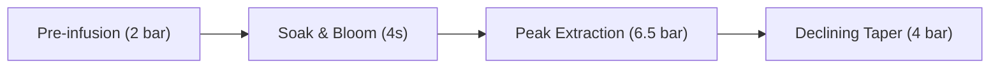

# The Physics of Espresso Extraction

Espresso extraction is a rapid, high-pressure solid-liquid extraction through a porous, deformable bed of ground coffee. Because this article has the newest publish date (`2026-03-01`), the **Coffee** category is placed at the very top of the home page, while inside the category it appears *after* [[dialing-in-light-roasts|Dialing In Light-Roast Espresso]] (`2026-01-05`).

![[espresso-shot-chart.png|Espresso extraction telemetry curve — click to open the lightbox, scroll wheel or pinch to zoom, and drag to pan]]

## Darcy's Law & Puck Permeability

Volumetric flow rate $Q$ through a porous coffee bed of cross-sectional area $A$ and thickness $L$ is governed by Darcy's Law:

$$
Q = \frac{\kappa A \Delta P}{\mu L}
$$

where $\kappa$ is the intrinsic permeability of the coffee puck, $\Delta P$ is the pressure drop across the bed, and $\mu$ is the dynamic viscosity of water at brewing temperature $T$.

> [!note] Inline Code in Callout Title: Using `ΔP <= 6.5 bar`
> Above `9 bar`, fine coffee particles migrate and compact against the basket holes, *reducing* $\kappa$ faster than $\Delta P$ increases.

## Pressure Profiling State Machine



## Computing Extraction Yield in TypeScript

```typescript
export interface ShotMetrics {
  doseGrams: number;
  beverageGrams: number;
  tdsPercent: number;
}

export function calculateExtractionYield({
  doseGrams,
  beverageGrams,
  tdsPercent,
}: ShotMetrics): number {
  return Number(((beverageGrams * tdsPercent) / doseGrams).toFixed(2));
}
```
