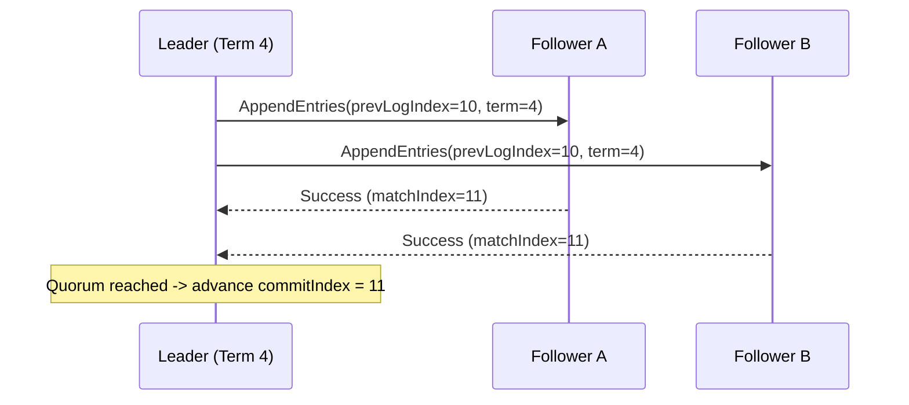

# Notes on Raft Consensus & Replicated State Machines

Raft decomposes consensus into three subproblems: **Leader Election**, **Log Replication**, and **Safety**. Because this article was published on `2026-02-15`, the **Systems** category appears second on the home page (right below **Coffee**, whose latest article is `2026-03-01`, and above **Writing**, whose latest article is `2026-02-01`).

![[distributed-raft-log.png|Raft Consensus Log Replication Pipeline — click to test the dark/light lightbox and wheel/pinch zoom]]

## Quorum Intersection Invariant

Any two majority quorums $Q_1, Q_2 \subseteq S$ in a cluster of $N = 2f + 1$ nodes must overlap by at least one server:

$$
|Q_1 \cap Q_2| \ge 1
$$

> [!warning] Never Commit Logs from Previous Terms by Counting Replicas Alone
> A newly elected leader in term $T$ must commit at least one entry from its **own** term $T$ before advancing `commitIndex` for older uncomitted entries (see the [Raft Paper](https://raft.github.io/raft.pdf)).

## AppendEntries RPC Sequence

See also [[memory-allocators|Arena & Slab Memory Allocators in Systems Programming]].
